  

  

  I build backend systems, integrations and interfaces for a multiplayer server with real users.

  
  

---

## 🧑‍💻 About me

- 💼 I develop and maintain systems for a multiplayer server on **FiveM**: client/server logic in Lua, MariaDB/MySQL databases and interfaces in HTML, CSS and JavaScript.
- 🏢 Former **Junior Developer at Meta Consultoria** (2024–2025, starting as an intern): enterprise systems maintenance and support tickets with **C#/.NET, Java, SQL Server and Oracle PL/SQL**.
- 🔭 Currently building **LicenseHub**, a software licensing API in .NET 10.
- 🤖 I use AI every day (Claude Code, Codex) to speed up development, always reviewing and understanding the code that goes to production.
- 🇧🇷 Brazil · UTC-3

## 🛠️ Tech stack

**Back-end**

**Databases**

**Front-end**

**Tools**

## 🎮 Projects

| Project | What it does |
|---|---|
| **[LicenseHub](https://github.com/IsaacRedel/LicenseHub)** | Software licensing API in .NET 10: keys stored only as hashes, ECDSA-signed responses, replay protection, rate limiting and activation limits enforced with a database row lock. Integration tests against a real MariaDB (Testcontainers). 🚧 In progress |
| **[FiveFly](https://github.com/IsaacRedel/FiveFly)** | Open source music player for FiveM: lb-phone app, desktop panel, playlists, profiles and spatial audio through speakers and vehicles. Works with Qbox, QBCore, ESX and vRP. [▶ Live demo](https://isaacredel.github.io/FiveFly/preview.html) |

## 📫 Let's talk?

Open to exchanging ideas, collaborations and interesting projects. Reach me on [LinkedIn](https://www.linkedin.com/in/isaac-redel-9459a5263/) or by [email](mailto:isaacnovaes@gmail.com).

   
  🕷️ Fun fact: I'm a huge Spider-Man fan.

