  

  Crio sistemas backend, integrações e interfaces para um servidor multiplayer com usuários reais.

  
  

---

## 🧑‍💻 Sobre mim

- 💼 Desenvolvo e mantenho sistemas para um servidor multiplayer no **FiveM**: lógica cliente/servidor em Lua, banco de dados MariaDB/MySQL e interfaces em HTML, CSS e JavaScript.
- 🤖 Uso IA no dia a dia (Claude Code, Codex) para acelerar o desenvolvimento, sempre revisando e entendendo o código que vai para produção.
- 🔭 Atualmente estudando **C# e .NET** e construindo projetos com eles.
- 🇧🇷 Brasil · UTC-3

## 🛠️ Tecnologias

**Uso no dia a dia**

**Também trabalho com**

## 🎮 O que já desenvolvi

| Projeto | O que faz |
|---|---|
| **Pesadelo** | Modo de terror assimétrico (1 assassino vs até 4 sobreviventes), com lobby, HUD e tela de resultado |
| **Pool de Doações** | Várias metas de doação simultâneas; ao bater 100%, a meta libera um buff para o servidor inteiro, e buffs de pools diferentes podem ficar ativos juntos |
| **Leilão** | Sistema de leilão dentro do jogo, com interface própria |
| **Blitz Policial** | Ferramentas para a polícia montar bloqueios: cones, barricadas e tapetes de pregos |
| **Jornalzinho** | Aviso de atualizações no HUD e quadro de changelog no menu ESC |

## 📫 Vamos conversar?

Aberto a trocar ideias, colaborações e projetos interessantes. Me chama no [LinkedIn](https://www.linkedin.com/in/isaac-redel-9459a5263/) ou por [e-mail](mailto:isaacnovaes@gmail.com).

   
  🕷️ Curiosidade: sou muito fã do Homem-Aranha.

